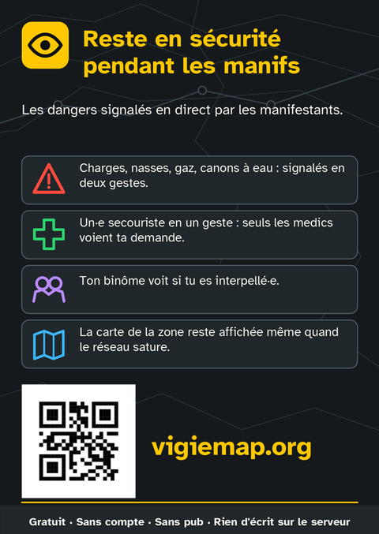
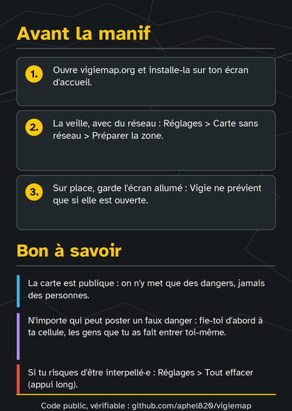
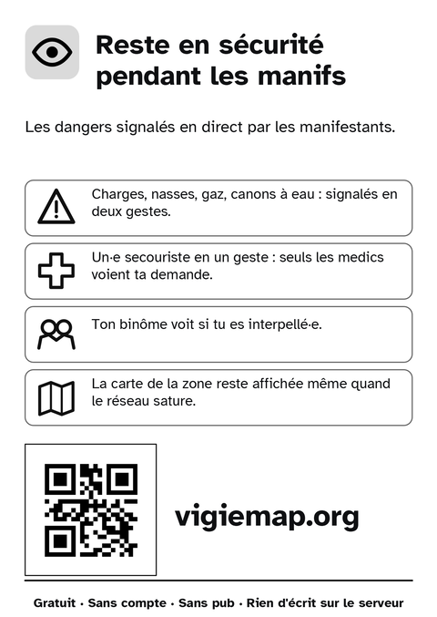
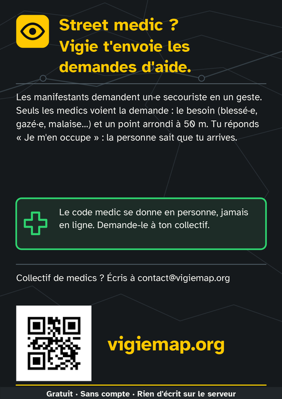
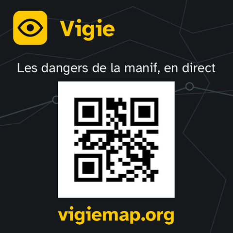

# Kit d'impression

Des flyers et un autocollant pour faire connaître Vigie. Imprime-les, photocopie-les, distribue-les :
ils sont libres (voir [Licence](#licence)).

| | Fichier | Format | Pour qui |
| --- | --- | --- | --- |
| A | [vigie-A-flyer-recto-verso.pdf](vigie-A-flyer-recto-verso.pdf) | A6 recto verso, couleur | Tout le monde |
| B | [vigie-B-flyer-noir-et-blanc.pdf](vigie-B-flyer-noir-et-blanc.pdf) | A6 recto, noir et blanc | Photocopieuse, imprimante laser |
| C | [vigie-C-autocollant-70mm.pdf](vigie-C-autocollant-70mm.pdf) | Autocollant carré 70 × 70 mm | Tout le monde |
| D | [vigie-D-flyer-street-medics.pdf](vigie-D-flyer-street-medics.pdf) | A6 recto, couleur | Street medics et leurs collectifs |

Tous mènent à https://vigiemap.org, par le QR code et en toutes lettres.

## Imprimer

- **Chez un imprimeur** : commande le format fini (A6, soit 105 × 148 mm, ou 70 × 70 mm pour
  l'autocollant) avec fonds perdus. Les fichiers sont prêts : 3 mm de fond perdu autour des flyers
  (fichier de 111 × 154 mm), 2 mm autour de l'autocollant, 300 dpi. Les couleurs sont en RVB :
  l'imprimeur les convertit, le jaune tient bien.
- **Chez toi ou en photocopie** : imprime à 100 % (taille réelle), jamais « ajuster à la page », puis
  découpe. La version B est faite pour ça : fond blanc, pas de grand aplat qui bave.
- **Avant d'en tirer beaucoup** : imprime un exemplaire et scanne le QR code avec un vieux téléphone.

## Licence

Les fichiers de ce dossier sont dédiés au domaine public par leurs auteurs, sous
[CC0 1.0 Universel](https://creativecommons.org/publicdomain/zero/1.0/deed.fr) : tu peux les
imprimer, les modifier, les traduire et les diffuser sans demander ni citer personne. Le code de
Vigie, lui, reste sous AGPL 3.0 ([LICENSE](../LICENSE)).
